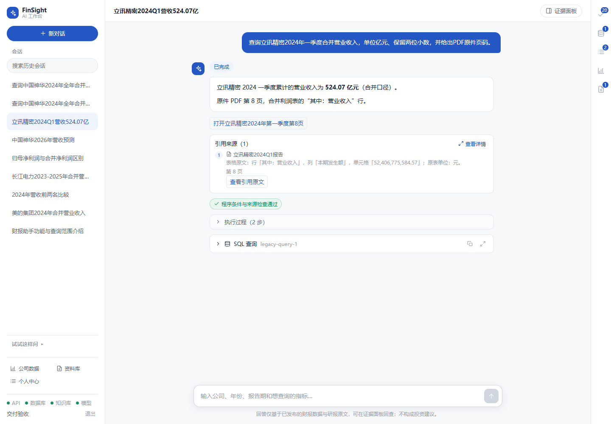
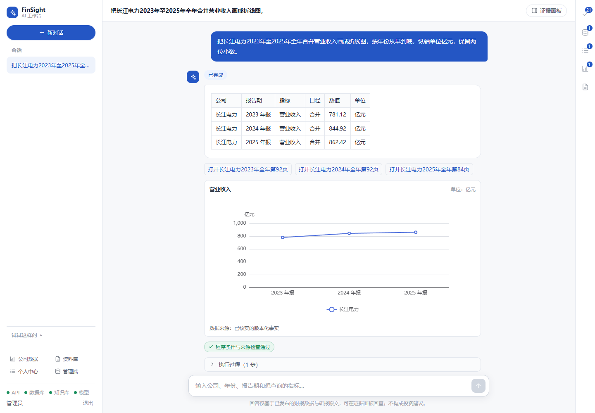
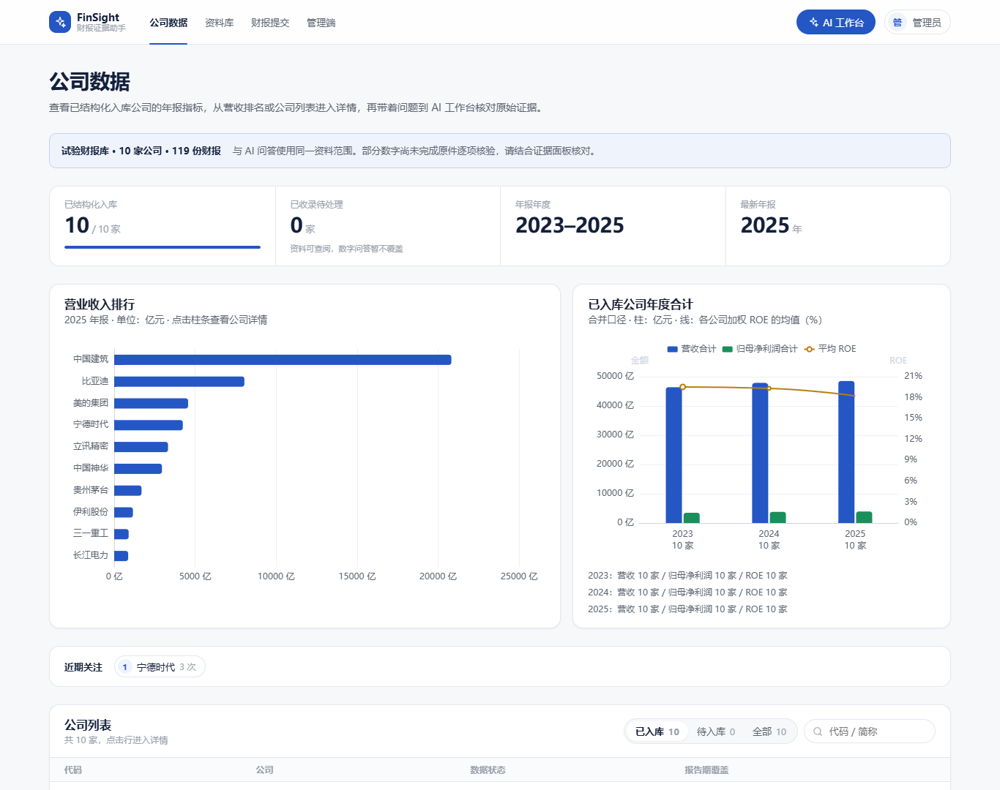

# FinSight财报证据助手

算法主题赛（AI开源）技术报告

参赛方向：开源赋能的AI应用创新

团队名称：凌云队　团队编号：AIC-2026-96123955

| 成员 | 实际分工 |
|---|---|
| 黄俊仪 | 主要完成项目检测报告 |
| 麦明政 | 完成代码实现和代码审核 |

成果仓库：https://github.com/mzmai0658-source/FinSight/tree/codex/aic-96123955-final

报告日期：2026-10-29。交付版本：FinSight-AIC-2026-96123955-r3。报告依据最新候选的真实Java/SSE问答、程序检查和可追溯数据版本；不将历史本地模型分数计入当前成绩。源码、报告和公开核验材料按本次提交分支交付，固定提交与文件校验值见随包回执。

摘要：FinSight面向上市公司财报查询、比较和原文核对。DeepSeek Flash负责理解用户意图、组织叙述和证据审核；程序执行只读查询、Decimal计算、图表和来源检查。用户上传PDF后，PaddleOCR-VL-1.6生成JSON与Markdown，系统形成候选，管理员确认身份并审核后才可严格发布。百炼text-embedding-v4产生1024维向量，Chroma保存叙述索引。当前试验问答库来自10家新公司119份真实财报，包含7607条事实、21437个片段；保留1400条未核验事实及相关风险标记。最新64轮同题回归完整处理46轮，24轮自然改写完整处理18轮，合计64/88；该结果反映有限工程测试，不是第三方盲测、全市场准确率或比赛通过结论。

默认资料为独立ocr_trial试验版本，保持experimental / relaxed_ocr与source_audit_complete=false。严格serving的3份已审核报告和试验119份分别管理，未批准的用户上传不会自动进入正式共用库。旧117份/BGE资料保留历史身份，不与新库混查。本阶段未开展真实用户试用；视频由团队后续拍摄，本文提供经排练的样例和操作顺序。

## 1. 应用问题、需求和实现目标

### 1.1 读财报时最容易发生的错误

财报查询并不是找到一个同名字段就结束。读者说“净利润”，可能是合并利润表的净利润，也可能关心归属于上市公司股东的净利润。母公司利润表反映母公司单体经营，归母指标则来自合并成果的股东归属。两者都含“母公司”三个字，却不能互换。类似地，营业收入、营业总收入和主营业务收入并非同一指标；半年和前三季度是累计期间，不能冒充单个季度。

这些区别在连续追问中会进一步放大。例如先要求“2023年合并营收、万元、只给表格”，随后说“美的换成比亚迪”，本轮应该只换公司。如果模型重新猜一遍整个问题，年份可能丢失，单位可能变回默认值，表格也可能变成长段解释。模型即使给出数据库里确实存在的数字，仍可能没有完成用户原来的要求。

另一个问题是证据不对题。某段文字确实来自这家公司的年报，并不能证明它解释了本期营收下降。原始表格用元，回答用亿元，也不能把换算后的句子放进引号，声称是报告原文。FinSight因此分别检查数字一致性、请求满足度和证据支持度，不把“有一个真实出处”等同整个回答正确。

### 1.2 需求优先级和服务边界

| 优先级 | 用户需求 | 本作品采取的处理 |
|---|---|---|
| 首要 | 数字、单位与口径正确 | 明确指标身份，保留十进制精度，查询已验收事实 |
| 首要 | 连续修改条件不丢失 | 版本化状态与字段级操作，记录修改依据 |
| 首要 | 能回到原始财报 | 文件内容摘要、物理页、原始行列和原始单位绑定 |
| 其次 | 比较、排名和图表 | 程序计算与排序，图表点引用事实，缺失保持空值 |
| 其次 | 解释概念与经营原因 | 固定财务定义与对应期间叙述证据，缺证据时说明 |
| 配套 | 刷新恢复与停止生成 | 固定任务ID、持久任务记录、取消和终态保存 |

目标用户是需要学习、比较和核对上市公司财报的读者。本作品提供披露数据查询和解释，不提供买卖建议，不推断未披露经营事实。当前新语料覆盖10家登记公司，严格发布范围以已审核的现用版本为准；支持年报、半年报、一季度及前三季度累计口径。单季拆分、全市场覆盖和模型微调不属于当前已完成能力。缺公司且上下文不明确时询问，缺年份默认最新年报，泛称净利润默认归母并写明。

本阶段没有真实用户试用，因此不宣称节省阅读时间、改善学习效果或提高满意度。可验证成果是固定工程题库中的完成率、财务原件核对、真实接口运行和软件测试，而不是虚构的用户反馈。

## 2. 总体架构和模型分工

### 2.1 服务组成和一次回答的流程

Vue负责登录、财报提交、候选审核、会话、表格、图表和原页查看。Java负责鉴权、归属、任务登记、SSE转发、保存及恢复，PDFBox在上传前检查PDF资格。Python使用LangGraph组织理解、状态更新、执行、取证、核验和输出，通过HTTP调用DeepSeek；MySQL保存规范事实、版本及业务状态，Chroma保存百炼向量，Redis用于令牌与配额，RabbitMQ调度异步任务。财务查询使用独立SELECT账号；ETL和发布使用不同权限。

<!-- architecture -->

一次普通查数先经过模型的紧凑结构化提案：任务目标是什么、本轮修改哪些条件、引用哪个上下文、哪些事项需要澄清。程序将提案编译为v3请求，检查公司和指标目录、时间选择、单位适用性以及明确限制。随后参数化读取事实，计算与展示，核对来源和要求，最后保存任务结果。最终财务正文不是由模型自由填写数字。

普通查数通常只需要一次模型理解调用；格式或条件失败可以进行有界修正。经营原因解释需要理解、组织结论和核对证据，调用更多、失败风险也更高。每轮最多6次模型调用，单次最长60秒，仍受整轮截止时间约束。Python执行最多240秒，整轮默认270秒，并为保存预留时间。后台标题等调用也进入统一调度，不应绕过模型资源限制。

### 2.2 模型与程序各自负责什么

同一模型反复自评不能提供真正独立的判断，理解错误也可能在后续审核中重复出现。FinSight把可精确判断的部分交给程序：公司代码是否登记、指标是否支持、单位是否匹配、条件操作是否合法、执行结果是否覆盖要求。复杂叙述仍使用云端证据审核，但审核可能出错，实际评测继续单列原文支持和人工复核状态。

模型输出结构受类型约束，但类型合法不等于含义正确。一个合法的公司列表仍可能选错公司，一个合法的报告期仍可能误解用户。所以程序保存本轮原话、修改依据、理解诊断和实际执行条件，遇到未满足要求时阻断或如实标记未完成。缓存只能减少重复准备，不能绕过同一套条件与来源检查。

| 环节 | DeepSeek云端负责 | 程序负责 |
|---|---|---|
| 听懂要求 | 意图、条件修改、上下文引用提案 | 登记值、操作、明确冲突和格式检查 |
| 查询与计算 | 不直接生成财务结果 | 只读SQL、期间选择、Decimal计算 |
| 图表与表格 | 提案中保留展示要求 | 点值、空值、排序、单位和舍入 |
| 经营解释 | 基于给定片段组织语言 | 文件/期间过滤、引用身份和数量限制 |
| 完成与保存 | 不自填“全部完成” | 实际目标状态、分项核验、终态保存 |

### 2.3 自研边界和已有方法的借鉴

FinSight自研部分是统一请求与状态协议、条件编译、财务身份模型、确定性执行、来源绑定、候选审核发布、持久任务恢复和验收工具。LangGraph、MySQL、Chroma、Redis、RabbitMQ、Java/Vue框架及三个云端模型服务均为第三方资源，不列为原创算法。云端生成和识别服务不因代码开源而成为本作品权重；本作品没有训练新的金融模型。

FinGLM的公开方案将财务问答与结构化数据处理结合，启发本作品减少让模型承担精确查数。TAT-LLM强调表格与文本中的金融数值推理，本作品借鉴“理解与计算分离”的工程方向，由程序完成算术，并非复现其训练方法。ConvFinQA提供连续金融问答任务，启发对逐轮上下文和事实引用进行独立测试。本作品不直接声称优于这些项目：数据、模型和评测条件不同，没有同条件对照实验。

可核查参考：[FinGLM](https://github.com/MetaGLM/FinGLM)、[TAT-LLM](https://github.com/fengbinzhu/TAT-LLM)、[ConvFinQA](https://github.com/czyssrs/ConvFinQA)。采用资源的实际版本、来源、许可和义务见第三方资源附件。

## 3. 真实财报数据、指标与证据建模

### 3.1 新语料范围与处理状态

本轮使用10家新公司的120份真实PDF，年份为2023、2024、2025，每年包含FY、HY、Q1、Q3。原件清单记录官方披露地址、内容SHA-256、页数和文件大小；下载与身份核对是资料准备证据，不能替代财务单元格核验。旧10家公司的117份报告及BGE索引仍在本地保存，与本轮新语料分别管理。

| 公司 | 原件数 | 本轮新OCR数 |
|---|---:|---:|
| 美的集团 | 12 | 12 |
| 比亚迪 | 12 | 12 |
| 贵州茅台 | 12 | 12 |
| 长江电力 | 12 | 12 |
| 中国建筑 | 12 | 12 |
| 立讯精密 | 12 | 12 |
| 宁德时代 | 12 | 12 |
| 伊利股份 | 12 | 12 |
| 中国神华 | 12 | 12 |
| 三一重工 | 12 | 11 |
| 合计 | 120 | 119 |

三一重工2025年一季报尚未取得可确认的完整新OCR，保留待对账，不自动重复付费提交。其余119份报告已进入试验事实与叙述索引；这只说明处理覆盖，不等于每个指标均提取齐全。not_found表示当前提取和核验未取得该项，不直接推断未披露；缺项不补零，不换期间。

冻结数据版本为caaa851bfac89f33498e0c8c4569582214a048b45c05dc49a173090889202b6a。7607条事实中，5554条为程序核验值、1400条未完整核验、653条为派生值。派生值保留公式和输入状态，不能因完成计算就升级其可靠性。向量集合financial_cloud_9386cb8d99c713495e245e4dc587b265覆盖21437个片段，使用text-embedding-v4/1024及固定document/query约定。

历史118份、7298条事实和21418个片段属于前一版本。当前统计来自冻结版本清单，不修改旧验收记录，不将原件已下载、OCR已完成、已入库、严格核验四个状态混为一谈。表头、跨页单位、百分比/金额及每股口径的程序修复保留反例验证；仍有原件核对缺项，接受少量漏提取，但不编造补齐。

事实状态区分verified、unverified和derived。verified表示当前程序按已登记规则取得原件支持，不是团队成员人工逐格审核；unverified继续保留未完整核实提示。derived保留公式及输入ID，若输入未核验，计算值也不能写成完整核验通过。OCR试验配置的source_audit_complete仍为false，不得把试验接通冒充全部严格审核完成。

### 3.2 数字必须带有完整身份

| 内容 | 示例或含义 | 防止的错误 |
|---|---|---|
| 公司、年度、报告期 | 600085、2024、FY | 跨公司、跨年或累计期间替换 |
| 指标、报表范围 | 营业收入、consolidated/parent | 同名口径混用 |
| 数值、单位、精度 | 十进制字符串、元、原始小数位 | 浮点损失和换算错误 |
| 来源与版本 | PDF SHA-256、物理页、原始行列 | 指向旧文件或无关页 |
| 原始内容 | 原值、原始单位、原始行名 | 将答案改写冒充逐字引用 |
| 状态与派生关系 | verified/derived、公式和输入ID | 未核实值或无依据计算被发布 |

合并净利润、归母净利润、扣非归母净利润使用不同指标身份。母公司净利润由净利润指标与parent范围共同表示，不覆盖合并数字。原有宽表保留供历史ETL兼容，由规范事实投影生成；当前公司页、资料库和关注列表与问答共同读取所选规范目录，不再将仅3条记录的旧表误作完整试验库。新Agent读取规范事实，不根据旧字段名称猜口径。核心指标里的归母净利润与利润表里的净利润合计分别映射。

营业收入、营业总收入和主营业务收入同样分别登记。加权平均ROE与扣非加权ROE区分；报告原文披露增长率与程序根据基础数字计算的增长率区分。别名只表达真正等价的名称，不允许用“相近”代替“相同”。每股指标和比率具有独立量纲，不能套用金额换算。

每股收益与加权平均ROE的术语参考中国证监会[公开发行证券的公司信息披露编报规则第9号（2010年修订）](https://www.csrc.gov.cn/csrc/c101864/c1024649/content.shtml)。本作品解释登记口径，并以具体原件决定取数；没有对其他报表体系或全部特殊股本情形进行完整验证。

### 3.3 原件检查与版本发布

数值来源首先核对PDF实际字节摘要、页码范围和报告身份，再核对表格行、期间列、单位、精度和报表范围。坐标证据读取相应PDF区域；原文字面证据检查原值在原页及登记行内的位置。OCR缓存用于复用提取结果，不能替代原件核验。财务数值归一化后再与标准事实比较，同一文件中的母公司和合并报表分别核实。

毛利额等派生值仅在输入的公司、报告期、范围、单位和文件版本一致时产生。例如毛利额＝营业收入－营业成本，毛利率＝毛利额÷营业收入×100。派生事实保留输入ID和公式，分母为零时不能生成无穷大。严格发布要求输入通过核验；默认OCR试验可以对未完整核验候选执行计算，但必须保留输入状态，不能把派生值升级为完整核验通过。

普通上传使用user-financial-v1严格发布：管理员确认公司和报告期，检查数值、缺项与来源，再准备事实、报告目录、叙述索引和兼容投影，通过检查后原子切换serving指针。一轮请求固定数据版本和集合。本轮默认问答使用ocr-trial-v1及独立ocr_trial指针，保留experimental / relaxed_ocr和未核验状态；上传页原有失败与待审核记录不改写。原件、OCR或向量仅在内容身份、文本、元数据和嵌入配置匹配时复用。

PDF上传后按摘要登记，远端OCR提交前持久保存页数预留和任务身份；取得作业号后中断只续查原作业。提交结果不确定时先对账，不自动重付费提交。新的OCR JSON用于表格抽取，MD及正文用于叙述分块，二者都绑定PDF与OCR摘要。来源冲突、缺失和识别异常单独保留。

向量使用百炼HTTP接口，固定模型text-embedding-v4、1024维与document/query约定。当前实现指纹为dashscope:text-embedding-v4:dim=1024:algorithm=dashscope-dense-v1:document=document:query=query。集合清单同时记录分块版本、覆盖报告和来源摘要；查询前检查身份，不能把旧BGE集合改名当作迁移。数字出处使用事实定位，经营原因使用叙述检索，两条证据路径不能互相代替。

## 4. Agent对话、条件操作与任务恢复

### 4.1 用明确操作更新条件

对话状态分别保存财务条件、待澄清请求、最近受验证事实、派生计算引用、实际执行记录和话题信息。模型提出本轮修改，程序执行替换、添加、删除、仅保留、沿用和清空。没有明确修改的条件继续保留，不重新猜整份请求。修改记录保存本轮原话中的依据，便于复核条件为什么变化。

| 用户表达 | 操作 | 应保留的内容 |
|---|---|---|
| 美的换成比亚迪 | 替换指定公司 | 另一家公司、年份、指标、单位与形式 |
| 再加宁德时代 | 添加公司 | 原公司集合和其余条件 |
| 去掉其他，只留比亚迪 | 仅保留公司 | 其余财务与展示要求 |
| 别查营收，改归母 | 替换指标 | 公司、年份、单位，不继续输出营收 |
| 改成2023年，其他不变 | 替换年份 | 报告种类、口径、小数位等 |
| 换话题，不延续刚才公司 | 清空公司引用 | 后续不能盲用旧公司 |

公司识别依据登记名单、代码和明确上下文。“母公司股东”是财务概念，不当作新组织；“库内公司”是集合范围。用户提到被删除的公司，并不代表要求查询它，审核需要按集合操作计算最终选中、排除和引用的公司。

### 4.2 插话、事实引用和前提纠正

概念插话与财务条件分别管理。先查询营收，再解释扣非，不应永久覆盖刚才的营收任务；明确“回到刚才营业收入”可恢复对应财务条件。如果存在多个可能的指代，系统应询问，不能挑一个旧数字充当最近事实。

最近事实引用登记实际事实ID、数据版本及核验状态，默认OCR试验中的未核验状态不能在追问中消失。没有查到数据、任务失败或取消，不得把旧数字当作本轮结果。例如2030年无数据后再问“刚才2030年的数”，应说明没有取得对应值，而不是重复2023年的金额。对“这个数是负的”先核对引用：如果上一事实为正，先纠正前提，再解释该指标的会计含义。净利润为负可以说明对应口径亏损，现金流为负则说明净流出，不能自动等同亏损。

### 4.3 固定任务身份和真实取消

每轮任务有固定任务ID和客户端请求ID，状态包括排队、执行中、正在取消、完成、取消和失败。Java检查任务归属，Python保存任务与终态。重复提交同一请求ID按既有任务恢复，不通过“问题文字一样”猜任务是否相同。刷新、切换页面和短时断网不触发取消；恢复时依据服务端真实任务状态获取已保存结果。

点击停止后，Java向Python发出取消，Python停止后续工具执行、取消可中止的异步模型请求并丢弃迟到结果。只读SQL受短超时约束，执行结束后也不能继续发布已取消结果。取消、完成、重复done和迟到事件通过原子更新确定唯一终态。保存失败必须显示未保存，不能把流结束当作持久化成功。

应用内问答模型默认同时执行1个任务，最多排队8个；排队超过30秒或已满时明确提示忙碌。这是本机资源限制的一部分，不是问答准确率指标。真实取消、服务重启和用户隔离需要单独联调证据，不能由200题普通问答成绩推断已全部通过。

## 5. 确定性计算、展示与三项核验

### 5.1 时间、计算和舍入

明确指定期间时按原要求查询。多公司比较和排名默认共同最新，逐家查最新默认各自最新，用户明确要求优先。最近自然年按评测日期对应的完整日历窗口计算，不用有数据的旧年替换缺年。跨公司比较保持同期间和同口径，跨年比较保持同公司和同指标。

所有财务计算使用Decimal，输入保留原始精度，展示时才舍入。跨年差额为后期减基期；明确“第一家公司减第二家”按提问顺序计算。百分比指标的百分点变化是直接相减，相对百分比变化则按差额除以基期绝对值。负基期采用绝对基期并说明，由亏转盈同时解释符号变化。零基期增长率未定义，不能输出假百分比。已披露增长率不能再次作为基础金额计算“增长率的增长率”。

金额支持元、万元、亿元换算；元/股和百分比维持自身量纲。排名记录方向和数量，缺失项不参加数值排序，并说明范围是本次选中的库内公司，不冒充全市场排名。图表点由程序产生并引用事实，负数保持负数，缺失保持空点，不同单位不共用未经说明的坐标轴，只有一个点时不伪造趋势线。

### 5.2 三项核验分别回答什么问题

| 核验 | 主要检查 | 不代表什么 |
|---|---|---|
| 数字一致性 | 原始值、单位、精度、公式、事实和文件身份 | 不能单独证明听懂了用户 |
| 请求满足度 | 公司、期间、指标、口径、否定与展示限制 | 条件合法不能证明经营解释正确 |
| 证据支持度 | 原句是否真实、片段是否支持具体结论 | 文件真实不等于片段相关 |

普通查数取消同模型逐项布尔自评，程序检查确定条件；复杂经营解释仍有证据审核。审核结果只作为一项证据，不是最终验收的正确标签。财务正文、图表点和可程序判定的正负结论由程序生成。每个目标状态依据实际执行与核验确定，遗漏目标不能因任务数量碰巧相等而显示全部完成。

最新结构修复保留可靠的公司目录和年份规范化，但撤掉多处依据整句关键词覆盖正确提案的规则。指标匹配是候选和合法性依据，不能用短别名静默替换完整指标。公司修改、目标局部条件和持续偏好统一在请求与状态内计算。程序检查能够精确判断的关系；合法Schema和目录检查不等于已经完全理解自然语言。

单值先给结果，规则问题直接解释实际规则，概念问题解释定义，“盈利还是亏损”直接给对应口径结论。证据、SQL和内部ID放在详情，正文避免重复介绍、固定追问和无关定义。“只要表格”“不画图”“不要重复金额”等要求也检查实际正文和图表，不能只检查保存的合同字段。

### 5.3 经营原因的证据限制

原因检索按公司、期间、文件版本和指标筛选叙述。找到片段后逐条检查它是否真的支持“营收变化来自什么”，而不是仅提到了收入或行业。确实无依据时，保留可靠数值并说明原因未确认。数值变化本身不是原因证据，更不能将报告对未来的计划说成本期事实。

当前因果证据规则要求片段支持目标指标，例如营业收入的变动原因，不能把扣非利润原因段中出现的“营业收入增加”直接用作收入变化原因。该保守边界可能遗漏含蓄或跨段解释，更广泛原因解释仍有证据缺口。未取得合格证据时标记原因未确认，不说整份年报完全没有原因，也不把可靠金额返回等同原因目标完成。

逐字摘录使用原件文字。原件以元列示、答案换成万元时，换算说明单独呈现；原文行名、数值和单位保持原样。数字出处依据事实定位，避免向量检索返回看起来相似却不对应该数字的段落。

## 6. 验证设计、实际成绩和失败分析

### 6.1 固定条件与独立判定

使用DeepSeek实际响应型号deepseek-flash，temperature=0、关闭思考、单次上限3072 token、单次超时60秒、额外网络重试0次。普通理解允许一次结构纠错，总预算受任务截止时间约束。数据、索引和首次回答固定，多轮依照该组实际保存历史，不注入正确历史。数字、公司、指标、期间、单位和保存状态由程序检查，概念、边界和原因支持由开发辅助助手逐项复核，保留原始自动分数与追加复核，不让被测模型给自己打分。

官方文档在查阅时将deepseek-flash映射为DeepSeek-V4.1-Flash-1017；实验实际响应只确认API别名，不能据此冻结云端权重或保证未来完全复现。同一组对话的轮次相关，逐轮和整组结果同时报告。部分完成不给半分，环境失败和资料依据缺项均留在分母。当前没有预设及格线。

### 6.2 最新真实问答成绩

| 测试 | 完整处理 | 比例 | 四轮对话整组 |
|---|---:|---:|---:|
| 修复前相同64题，统一评分复核 | 44/64 | 68.75% | 见原记录 |
| 修复后相同64题 | 46/64 | 71.88% | 3/8 |
| 新24轮自然改写与对话 | 18/24 | 75.00% | 2/3 |
| 本轮合计 | 64/88 | 72.73% | 5/11 |

同一64题有9题由错变对、7题由对变错，净增加2题，改善幅度有限，不宣称显著提升或任意口语稳定。旧64份回答最初自动35题；当前评分器重评40题，加4题独立复核为44题，35到44属于评分校准而非模型进步。新64题自动42题加4题复核为46题；新24题自动15题加3题复核为18题。未要求的内部比较轴和按指标单位处理曾造成评分误拦，修正依据单独记录，原始答案和分数不覆盖。

64题是已见回归，24题是项目内自然改写，不称第三方盲测。正式云端尝试94次，包含失败与结构纠错；另有1次小型JSON连通检查。客户端中位耗时分别约4.92秒、4.74秒，包含一次续取和初期交错排队，不能视作独立吞吐基准。固定题的排练与后续录屏不加入这88轮成绩。

### 6.3 修复证据与失败位置

| 证据层 | 已取得记录 | 可支持的判断 |
|---|---|---|
| 本次修订程序测试 | Python1707通过、10跳过；Java142；Vue81及构建通过（2026-10-29） | 程序机制与边界检查，不代表答案正确率 |
| 定向保护测试 | 43条原失败及相邻行为验证 | 公司身份、年份、目标局部条件、状态和发布边界 |
| 正确任务条件重放 | 5/5通过，无注入答案、金额或来源 | 对这些代表题，正确条件可经真实程序取得正确结果 |
| 数据/原件清单 | 119份、7607事实、21437片段 | 覆盖与状态可追踪，不是逐格人工财务审计 |

24道失败中，10道为当前模型/接口问题，8道为数据或证据问题，6道为环境及连带问题。主要模型问题包括遗漏长期单位偏好、合并不同指标精度、原文追问漏掉不查数、能力问题误分任务和修改后误留比较类别。正确任务条件重放只用于诊断，不计入模型自主成绩，更不能据此认定所有程序问题已清零。

环境中出现两次60秒云端超时、一次连接/响应失败；初期两批交错执行使一题排队超过30秒，保留首次失败并改为顺序执行。另有上游失败后“照旧”需要重新明确条件的连带问题，这是保守恢复的程序可用性限制，不能都归给模型。证据缺项仍计失败，不将取到金额等同原因任务完成。

本次补充修复原件入口与趋势表格行序；r3进一步修复公司、资料、关注目录和页面可用性，未调整模型提示或重算上述88轮评测。历史195/200、264轮、324轮及旧本地模型成绩仅适用于各自代码、数据和评分；不与当前88轮拼接，也不作为当前云端系统的宣称。

## 7. 页面实测与录屏样例

### 7.1 既有录屏排练与当前适用范围

按能力介绍、查数、公司替换、原表整行、排名、三年趋势、概念与确定预测边界选取8轮演示，通过真实Java/SSE顺序执行并保存。美的2024年合并营业收入换算为4071.50亿元；只换为比亚迪后保留单位、精度、年份和表格，得到7771.02亿元；原件物理第10页的完整行保留原始元单位。排名只对选中的3家公司排序，前三年趋势的每点都有事实引用。概念与不支持预测不查询旧金额。

演示题经过选择，不是随机样本，不加入64/88成绩。排练连续请求一度触发限流，保存已完成记录，等待后只续跑剩余题，没有更换问题或修改程序追题。选定题、逐题输出与拍摄顺序保存在团队自用的演示指南和本地排练附件；r3没有重新连续执行这些生成题，不将旧排练写成新实测。

### 7.2 网页、恢复与图表

Browser插件不可用，采用已有Google Chrome与Playwright进行自动化核查，不称真实用户试用。桌面1440像素与手机390像素检查真实登录、会话历史、刷新、图表和原页。旧开发服务器的缓存曾产生图表初始化错误，新安装依赖的独立实例能够显示相同真实图表；未为此修改Agent或题目。首次独立实例请求出现60秒云端超时，失败保存；另行网络复核8秒返回，分别保留，不用成功覆盖首次。

本次修复快捷按钮丢失登记文件身份的问题，使其使用回答保存的不可变资产；兼容旧结构化来源URL并保持当前用户所有权检查。浏览器资产请求在多带Content-Disposition:inline时超时，同一原件仅去掉该头即恢复；未删除CSP、nosniff或鉴权。真实Chrome对比亚迪10MB原件、长江电力三年报告和立讯一季报共9次正常打开均为HTTP200、字节SHA匹配、原生PDF页码正确。历史切换/刷新、重复打开、受控404中文提示与重试、弹窗阻止后的备用链接也通过；成功路径未使用响应模拟。另在独立最小库复核立讯第8页原件，确认52,406,775,584.57元本期行。

### 7.3 演示数字与原件核对

另行核对9份冻结原PDF、9个营业收入数值、14个完整物理页、6份演示答案和5张已有截图；原件SHA、行列、本期/上期、合并口径、单位、Decimal换算及三家公司排名均匹配。美的物理第158页对应印刷第157页，避免页码混用；比亚迪摘要页金额经合并利润表再次互证。公开核验表保存来源链接、完整摘要、精确值与显示值，原PDF和完整页图另存，不将此工作扩大为全部7607条事实的人工审计。

长江电力2023—2025年图值781.12、844.92、862.42亿元采用各年原报告本期数。2024年报对2023年因同一控制下合并追溯调整：原报78,111,573,265.75元，重述后78,143,535,736.10元。因此该图不能声称采用统一重述后的可比口径。旧答案附表2023、2025、2024的行序已定位为数据库返回顺序，修复为按时间排列，金额排名逻辑另保留。在新建完整数据库和索引上重新执行同题，表格、图点、原件身份和刷新后历史均通过核验。

### 7.4 上传审核的已有证据

2026-10-22曾从网页上传立讯精密2024年一季报，复用相同PDF的新PaddleOCR缓存，形成41条严格候选；管理员角色通过自动化操作确认身份、批准并发布，严格serving扩至3份、106条事实。该流程证明当时版本交互接通，不等于团队逐单元格人工审计，也不冒充本次又付费重做OCR。首次聊天超时与后续成功均保留，跨用户详情/原件/候选访问被拒绝，取消终态及观察期无迟到发布另有记录。

当前源代码继续保留鉴权、审核门禁和质量字段校验，未批准上传不自动进入共用财报库。软件测试、页面实测、旧流程记录和本次安装回执分别列出；没有完整重复所有旧故障，不将少量演示推断为全面正确。

### 7.5 r3公司目录、资料入口和页面检查

原公司页、资料库和关注列表读取的旧表仅含3份季度资料，而问答已选择10家公司119份试验报告。r3统一所选版本、年度图、原件与示例，保留实验状态；严格最小资料只有3份季度报告时，年报图显示缺项说明。FY合并营业收入与归母净利润按各自身份展示，缺失值不计零，年度合计标明参与公司数。

真实Chrome复测搜索、分页、新公司详情与原件、关注和窄屏布局。中国建筑21,957,373字节原件HTTP200且摘要匹配，超过旧8MiB限制的下载已修复；119份本地PDF摘要均匹配登记身份。404白屏、管理端漏导入组件和故障提示、320像素上传框越界均已修复。正常路径采用真实服务，管理故障和单条示例布局另用明确拦截验证；不等同人工逐格财务审计或真实用户试用。

## 8. 安装复现与版本交付

源码包与真实资料分开提供。代码包不含密钥、用户历史、真实PDF、OCR、数据库快照、向量二进制、模型权重或第三方安装包。代码、配置模板、依赖锁、测试、运行说明与资源清单一并保留。新环境需要Windows、Python3.11、Node/npm、JDK/Maven、MySQL、Redis、RabbitMQ，并按需访问DeepSeek、百炼与PaddleOCR。当前云端架构不需要安装本地问答模型或GPU。

此前从候选ZIP解压到含空格的路径验证安装；本次修复后另用独立空数据库、只读账户、任务存储和Chroma目录验证恢复。依赖可复用下载缓存，不宣称无缓存下载。真实数据作为外部输入，restore_release.py按逐文件摘要恢复事实、来源和固定向量；保留实验状态，发布指针最后写入。该检查不等于重新付费OCR、重新抽取全部PDF或重新生成向量。结果在交付验收附件逐项记录，失败或未测项不填成功。

录屏题覆盖能力介绍、金额换算、公司替换、PDF整行、排名、趋势、概念和不确定预测边界，使用真实Java/SSE排练。演示经过选择，不能据此替代一般问法评测。已准备最小3份和完整119+3份外部资料包，百度网盘链接、视频和报名系统提交由团队完成；没有真实用户试用，不编写满意度、提效或学习效果数据。

最小复现使用完整既有严格release的3份报告、106条事实及57个片段，在全新MySQL库和Chroma目录恢复，独立只读账户及新任务存储启动。首次配置误用了已有只读账户而失败；保留记录，换新库、索引及专用账户后成功。立讯2024一季度查询得到524.07亿元、物理第8页；单位追问得到5,240,677.5585万元；缺失的比亚迪2024全年报告明确不补数。一次原表整行追问被模型请求规范拒绝，失败保存，没有删除或重抽来宣称全部通过。该组为安装冒烟，不加入64/88成绩。

## 9. 创新价值、风险控制和维护安排

作品的工程价值在于将“回答里有来源”推进为“要求、数值和证据分别可核对”。统一请求贯穿理解、执行、展示和保存，减少各层重复猜用户意思；版本化条件操作减少连续追问丢条件；规范事实与PDF身份减少财务口径混用；确定性计算和图表点减少语言模型自由算术；任务ID与保存状态让刷新、取消和恢复具有真实依据。这些是当前实现和验收的自主工作，不声称构成未经证明的新模型理论。

开源成果优先提供可审查代码、类型定义、题库工具、评分方法、安装说明和诚实结果。第三方框架、模型和参考方法的边界在资源清单标明。尚未有可核验的外部贡献、下载影响或真实社区反馈，因此不编写这些成果。团队为凌云队：麦明政完成代码实现和代码审核，黄俊仪主要完成项目检测报告。团队编号为AIC-2026-96123955。成员分工依据团队提供的信息；团队于2026-10-25确认、2026-10-26再次确认材料并授权本次修订：麦明政审核最新代码，黄俊仪审核最新报告，第三方许可、财报分享范围和AI生成内容来源/权利均已人工核查。该确认不扩大为对119份财报的逐单元格审计，最终PDF排版变化仍建议成员交付前复阅。

风险控制包括鉴权和归属检查、只读数据库账户、参数化查询、文件路径限制、原件摘要、模型输出类型检查、证据与数字门禁、预算和任务截止时间。财报文本作为数据，不能成为执行写SQL、泄露凭据或跨用户读取历史的指令。公开材料检查秘密信息与资源义务，测试输出不包含账号密码或内部令牌。

维护时先保留原件和版本，新增或更正事实需重新验收，不能覆盖已接受版本的历史摘要。问题反馈应提供脱敏问句、条件、任务ID和预期，避免上传个人凭据。修复按错误类别进入回归，再完整重跑固定验收；若需新增公司、支持单季、换模型或微调，作为独立范围变更处理。报告、运行说明和资源版本随代码更新，防止交付文件与实际服务漂移。

当前限制包括复杂意图与长对话理解失败、网络及额度约束、原因检索证据不足、全部事实尚未逐格核验，以及一份新OCR状态待对账。系统应保留未核验提示，如实澄清或失败，不能编造补齐。后续按实际错误改进抽取、检索和调度，继续执行请求与证据检查。

<!-- appendix -->
